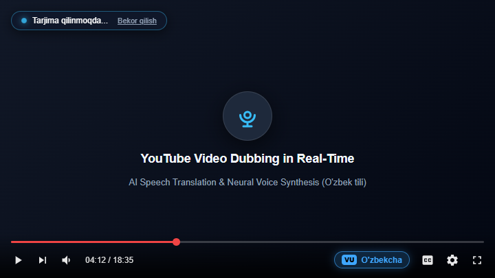
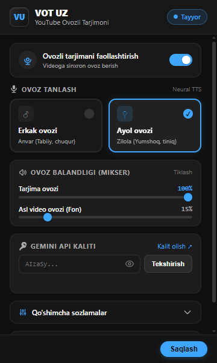

[English](README.md) | [O'zbekcha](README_uz.md)

# VOT UZ

**YouTube videolari uchun real vaqtda sun'iy intellekt yordamida o'zbekcha ovozli tarjima.**

---

## Dastur haqida

**VOT UZ** — bu YouTube platformasidagi chet tilidagi videolarni tomosha qilish jarayonida to'g'ridan-to'g'ri o'zbek tiliga tabiiy ovoz bilan sinxron tarjima qiluvchi ochiq kodli Google Chrome kengaytmasi. Tarjima Google Gemini API orqali amalga oshiriladi, o'zbekcha ovoz esa to'g'ridan-to'g'ri brauzeringiz ichida WebAssembly (Gapiring neyrotizimi) yordamida hosil qilinadi.

---

## Ko'rinishi (Preview)

| YouTube Pleyeridagi tugma va holat | Sozlamalar menyusi |
| :---: | :---: |
|  |  |

---

## Imkoniyatlari

- **Tezkor AI Tarjima:** Google Gemini API (`gemini-2.5-flash` / `gemini-3.5-flash-lite`) yordamida kontekstni hisobga olgan aniq tarjima.
- **Brauzer ichidagi ovoz sintezi:** Ovoz to'liq kompyuteringizda (WebAssembly / ONNX Runtime Web) hosil bo'ladi, begona serverlarga audio yuborilmaydi.
- **Tabiiy o'zbekcha ovozlar:** Erkak (`Anvar`) va Ayol (`Zilola`) neyron ovozlari orasidan tanlash imkoniyati.
- **YouTube pleyeriga integratsiya:** Pleyer boshqaruv panelida qulay "Ovozli tarjima" tugmasi va status xabarnomasi.
- **Asl ovozni avtomatik pasaytirish (Audio ducking):** Tarjima gapirilayotgan vaqtda video foni avtomatik pasayadi (masalan, 15% gacha).
- **Aqlli kutish va kutilmagan o'tkazishlar (Seeking):** Videoni oldinga yoki orqaga o'tkazganingizda, yangi vaqt uchun ovoz tayyor bo'lguncha video to'xtab turadi va tayyor bo'lgach avtomatik davom etadi.
- **Moslashuvchan sozlamalar:** Tarjima va fon ovozi balandligi mikseri, audio sinxronlik siljishi (offset) va avtomatik boshlash rejimi.

---

## O'rnatish

### 1-usul: Tayyor Release arxivini yuklab olish (Tavsiya etiladi)

1. [Releases](https://github.com/abdurazzoqo/vot-uz/releases) sahifasidan eng so'nggi `vot-uz-chrome-v1.0.0.zip` faylini yuklab oling.
2. Yuklab olingan `.zip` arxivini kompyuteringizdagi doimiy papkaga chiqaring (unzip).
3. Google Chrome brauzerida `chrome://extensions/` manzilini oching.
4. Yuqori o'ng burchakdagi **Dasturchi rejimi (Developer mode)** tugmasini yoqing.
5. **Paketsiz yuklash (Load unpacked)** tugmasini bosing va arxivdan chiqarilgan papkani (`manifest.json` joylashgan papkani) tanlang.

---

## Bepul Gemini API kalitini olish

VOT UZ tarjimasi uchun Google Gemini xizmatidan foydalanadi. Google AI Studio orqali 1 daqiqada bepul API kalit olishingiz mumkin:

1. [Google AI Studio](https://aistudio.google.com/app/apikey) sahifasiga kiring.
2. Google profilingiz orqali tizimga kiring.
3. **"Create API key"** tugmasini bosing va hosil bo'lgan kalitni nusxalab oling (`AIzaSy...` bilan boshlanadi).
4. Chrome panelidagi VOT UZ belgisini bosing.
5. **"Gemini API kaliti"** maydoniga kalitni joylashtiring va **"Tekshirish"** tugmasini bosing.
6. Yashil rangda "✓ Ulangan" chiqqandan so'ng, pastdagi **"Saqlash"** tugmasini bosing.

> [!NOTE]
> Sizning API kalitingiz faqat brauzeringizning shaxsiy xotirasida (`chrome.storage.local`) saqlanadi va uchinchi shaxslarga yuborilmaydi.

---

## Foydalanish

1. [YouTube](https://www.youtube.com) saytida istalgan videoni oching.
2. Video pleyerining pastki boshqaruv panelidagi **VOT UZ** tugmasini bosing.
3. Chap yuqori burchakda "Tarjima qilinmoqda..." yozuvi chiqadi va audio tayyor bo'lgach "Tayyor" statusi ko'rinib, 3 soniyadan keyin o'zi yo'qoladi.
4. Video o'zbek tilida so'zlasha boshlaydi!

---

## Sozlamalar izohi

Kengaytma belgisini bosganingizda quyidagi imkoniyatlar ochiladi:
- **Ovozli tarjimani faollashtirish:** Kengaytmani yoqish / o'chirish bosh kaliti.
- **Ovoz tanlash:** Erkak (`Anvar`) yoki Ayol (`Zilola`) ovozini tanlash.
- **Ovoz balandligi (Mikser):** Tarjima ovozi va fon (asl video) ovozini foizlarda mustaqil sozlash.
- **Qo'shimcha sozlamalar:**
  - *Avtomatik tarjima:* Har qanday video ochilganda tarjimani darhol o'zi boshlash.
  - *Videoni kutish (Gate):* Tarjima tayyor bo'lmaguncha videoni to'xtatib turish.
  - *Sekinlashtirish bilan sinxron:* Ovoz yetib kelishida kechikish bo'lsa, videoni biroz sekinlashtirish.
  - *Sinxron siljishi (Offset):* Ovoz tez yoki kech chiqayotgan bo'lsa, vaqtni ±3.0 soniyagacha qo'lda surish.

---

## Ko'p beriladigan savollar (FAQ)

#### Kengaytmadan foydalanish bepulmi?
Ha, kengaytma 100% bepul va ochiq kodli (MIT litsenziyasi). Google AI Studio taqdim etadigan bepul Gemini kvotasi oddiy video ko'rish uchun bemalol yetadi.

#### Ovoz chiqarish internetsiz ishlaydimi?
Birinchi marta foydalanganda neyron model (~30 MB) brauzer xotirasiga yuklanadi va shundan so'ng ovoz sintezi to'liq internetsiz, qurilmangizning o'zida ishlaydi. Biroq yangi jumlalarni tarjima qilish uchun internet va Gemini API kerak bo'ladi.

#### Videoni oldinga o'tkazganimda nega 1-2 soniya to'xtab turadi?
Kengaytma o'tkazilgan yangi nuqta uchun matnni tarjima qilib, yangi audio tayyorlab olishi uchun biroz vaqt kerak bo'ladi. Tayyor bo'lishi bilan video avtomatik ravishda davom etadi.

---

## Cheklovlar

- Kengaytma hozirda Chromium asosidagi brauzerlar (Google Chrome, Microsoft Edge, Brave) uchun mo'ljallangan.
- Tarjima sifati asl videodagi nutqning aniqligiga bog'liq.
- Jonli efirlar (Live Stream) va YouTube Shorts hozircha sinov holatida.

---

## Maxfiylik bayonoti

- **Hech qanday ma'lumot to'planmaydi:** Hech qanday shaxsiy ma'lumotlar, telemetriya yoki foydalanish statistikasi yig'ilmaydi.
- **Mahalliy saqlash:** Sizning API kalitingiz va barcha sozlamalaringiz faqat sizning qurilmangizda saqlanadi.
- **Tashqi so'rovlar:** Faqat ko'rilayotgan video havolasi va vaqt oralig'i to'g'ridan-to'g'ri Google Gemini API serveriga yuboriladi.

Batafsil ma'lumot: [docs/privacy.md](docs/privacy.md).

---

## Ogohlantirish

Ushbu loyiha mustaqil ochiq kodli ishlanma bo'lib, **Google LLC yoki YouTube kompaniyalariga aloqador emas va ular tomonidan homiylik qilinmagan**.

---

## Mualliflar va minnatdorchilik

- **Ovoz sintezi (TTS):** Islomov / Gapi.uz tomonidan ishlab chiqilgan [Gapiring](https://github.com/islomov/gapiring) neyrotizim modeli ([CC BY 4.0](https://creativecommons.org/licenses/by/4.0/)).
- **Tarjima modeli:** Google Gemini API (Google AI Studio).
- **WebAssembly dvigateli:** Microsoft Corporation tomonidan ishlab chiqilgan ONNX Runtime Web.
