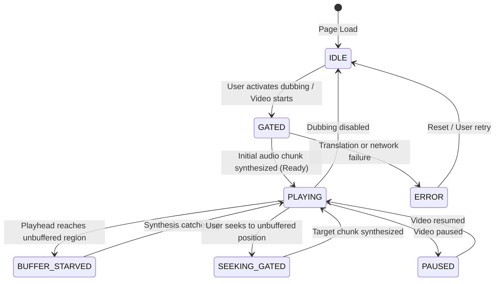

# VOT UZ Architecture Overview

This document describes the internal engineering architecture of **VOT UZ**, a real-time speech translation and neural voice dubbing Chrome extension for YouTube.

---

## 1. High-Level System Architecture

The extension consists of several coordinating modules:

```
[YouTube Video Player]
        │
        ├── Events (play, pause, seeking, timeupdate)
        ▼
[Content Script & Hook] ──> [Session State Machine (FSM)]
        │                                │
        │ Window Planning & Scheduling   ▼
        ├───> [Window Planner & Priority Scheduler]
        │                   │
        │                   ▼
        │         [Gemini API (Google AI Studio)]
        │         (Transcription & Translation)
        │                   │
        │                   ▼ [Translated Timed Sentences]
        │
        ├───> [In-Browser Neural TTS (Gapiring + ONNX Runtime Web)]
        │                   │
        │                   ▼ [Audio Waveform Segments]
        │
        ├───> [Rolling Buffer & Lookahead Cache]
        │                   │
        │                   ▼
        └───> [Audio Sync Controller & Mixer]
                    │
                    ▼
          [Web Audio API Output + Video Ducking]
```

---

## 2. Session State Machine (FSM)

The playback and dubbing lifecycle is governed by a finite state machine:



---

## 3. Synchronization and Drift Compensation

1. **Audio Ducking:** When translated speech plays, the original YouTube audio volume is smoothly ducked (default: 15% volume) to maintain clear intelligibility.
2. **Speed Normalization:** If translated sentences are slightly longer than the original speaker's phrase, the synthesis rate is dynamically scaled up to 1.1x to prevent speech overlap.
3. **Drift Adjustment:** The `AudioSyncController` computes the difference between the YouTube video `currentTime` and the expected speech `start` timestamp on each frame:
   - **Lead/Lag < 100ms:** Considered in-sync.
   - **Lag 100ms - 400ms:** Original video is subtly slowed down by 5-10% until audio realigns.
   - **Lag > 1500ms:** Outdated speech segments are safely dropped to prevent desynchronization.

---

## 4. Waiting Gate and Seeking Behavior

- **Initial Gate:** When loading a video with dubbing enabled, the player is temporarily held in a paused state while the first 25-second window is transcribed and translated. As soon as the first sentence audio is generated, the gate releases and video automatically plays.
- **Seeking:** When seeking to an un-translated position in the timeline:
  - In-flight requests for the old time range are canceled via `AbortController`.
  - The player enters `SEEKING_GATED` state with a status indicator overlay.
  - The new target window is requested with high priority.
  - As soon as the target audio is synthesized, the status switches to "Ready" and fades out, automatically resuming playback.
